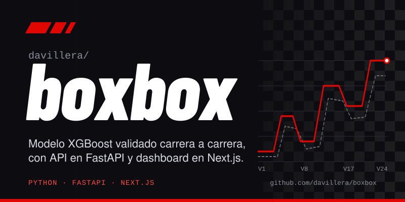
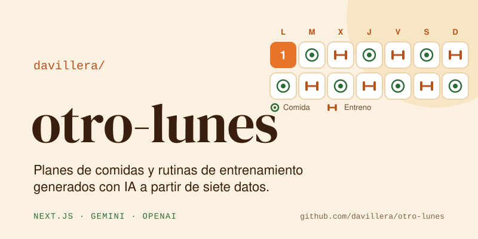
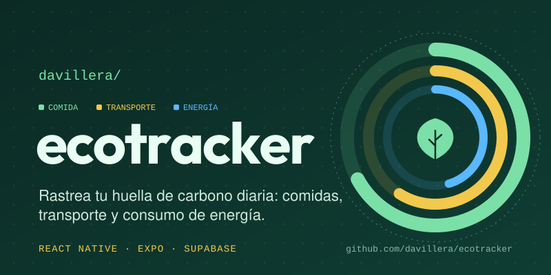
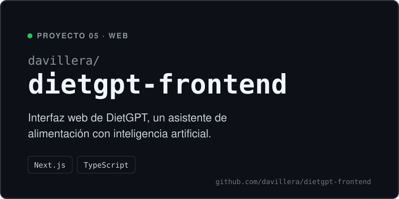

 

 

## 👋 Sobre mí

Soy Daniel, desarrollador full stack en Santa Marta, Colombia. Construyo aplicaciones web y móviles: APIs con **FastAPI**, interfaces con **Next.js** y apps con **Expo**.

Lo que más me gusta es llevar modelos de datos y de lenguaje a algo que la gente pueda usar. **BoxBox** predice los podios de Fórmula 1 y se reentrena después de cada Gran Premio. **Otro Lunes** arma planes de alimentación y rutinas de entrenamiento con IA a partir de siete datos.

Mi sitio y mi blog están en **[danielvillera.dev](https://danielvillera.dev)**.

## 🚀 Proyectos destacados

<table>
  <tr>
    <td width="50%" align="center">
      
    </td>
    <td width="50%" align="center">
      
    </td>
  </tr>
  <tr>
    <td width="50%" align="center">
      
    </td>
    <td width="50%" align="center">
      
    </td>
  </tr>
  <tr>
    <td width="50%" align="center">
      
    </td>  </tr>
</table>

## 🛠️ Stack

<b>Frontend</b> 

 

<b>Backend & datos</b> 

 

<b>IA & nube</b> 

