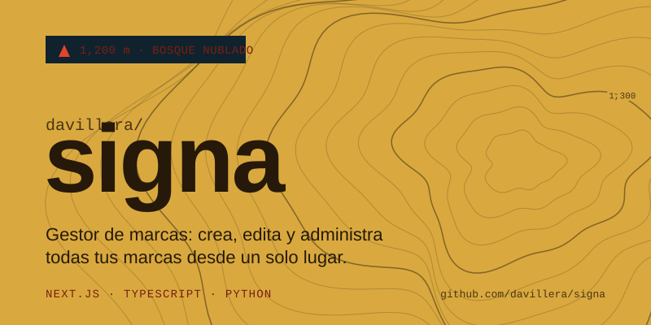
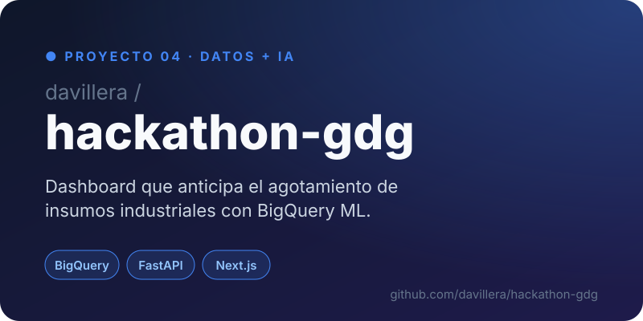

 

 

## 👋 Sobre mí

Soy desarrollador de software full stack en Santa Marta, Colombia. Construyo aplicaciones web y móviles, con APIs en **FastAPI** y frontends en **Next.js**, y integro modelos de lenguaje con **LangChain**.

Mi sitio personal y mi blog están en **[danielvillera.dev](https://danielvillera.dev)**.

## 🚀 Proyectos destacados

<table>
  <tr>
    <td width="50%" align="center">
      
    </td>
    <td width="50%" align="center">
      
    </td>
  </tr>
  <tr>
    <td width="50%" align="center">
      
    </td>
    <td width="50%" align="center">
      
    </td>
  </tr>
</table>

Más en [mis repositorios](https://github.com/davillera?tab=repositories): `davia-stock`, `chat-websocket-fastapi`, `diet-gpt-backend`, `empanadas_y_prompts_ieee_colcaribe`.

## 🛠️ Stack

<b>Frontend</b> 

 

<b>Backend & datos</b> 

 

<b>IA & nube</b> 

## 📊 Actividad en GitHub

